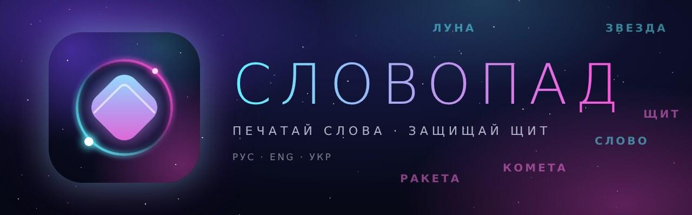
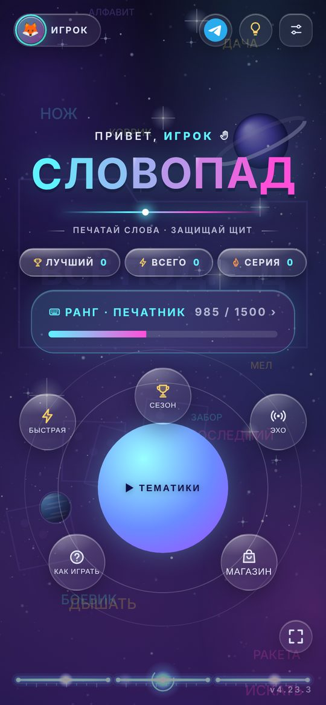
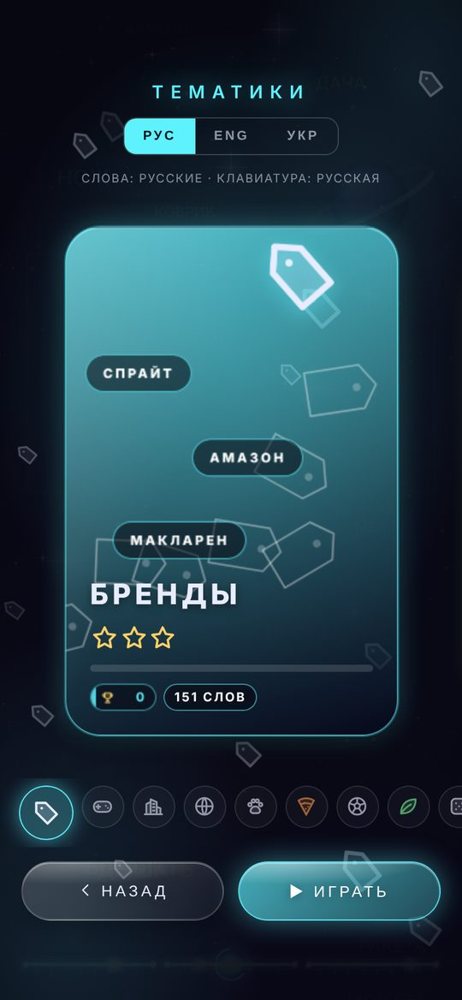
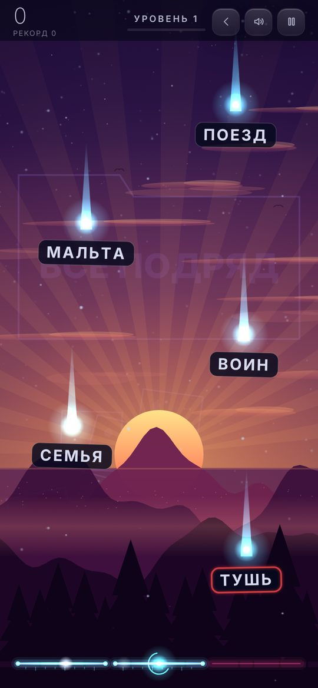
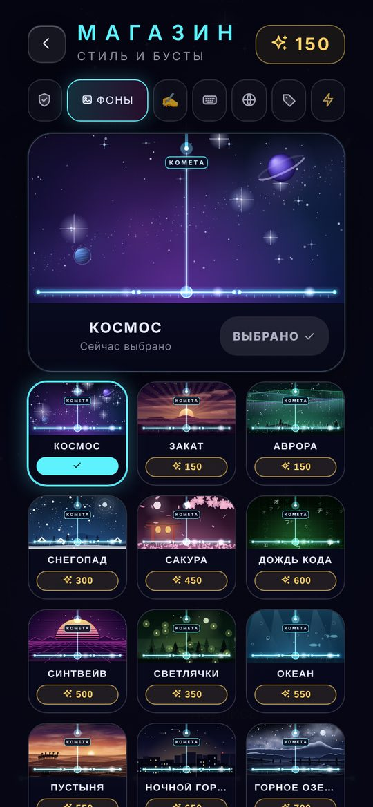
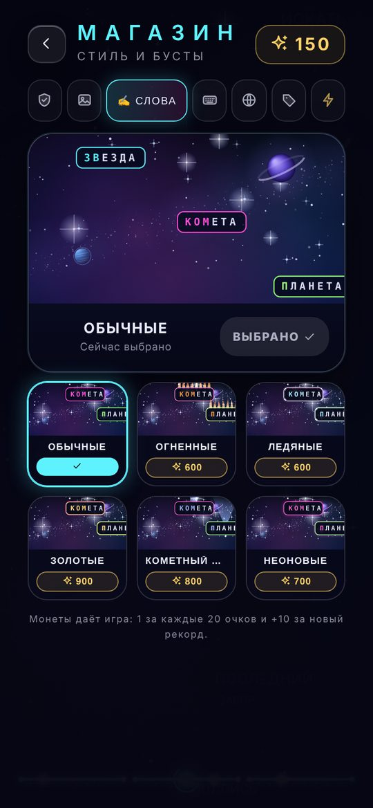
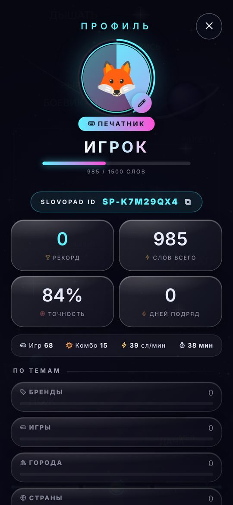
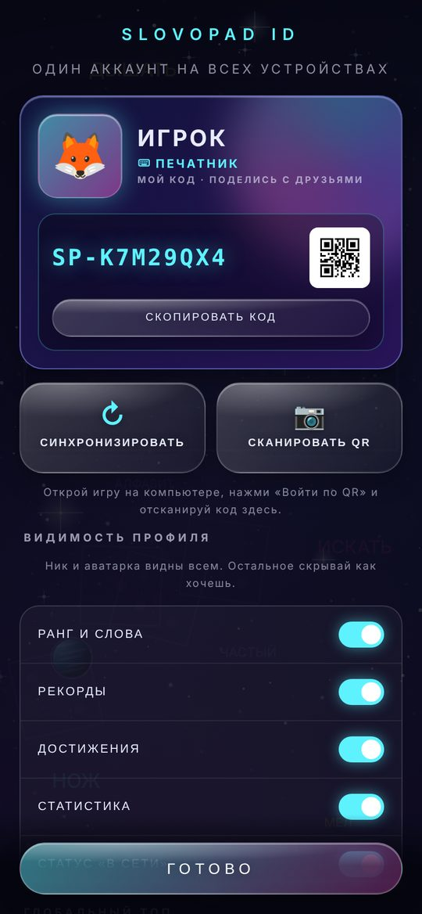
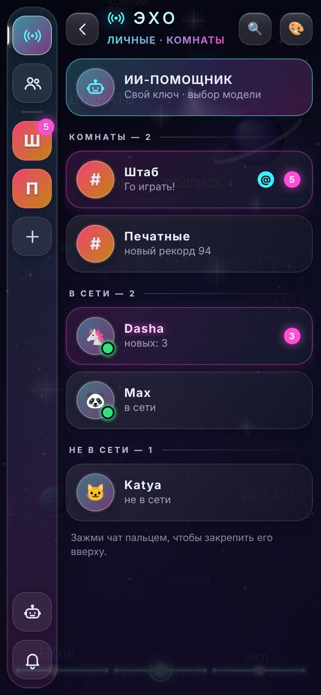

<h1 align="center">СЛОВОПАД</h1>

<b>Аркадная игра на скорость печати.</b> Слова падают сверху, ты печатаешь их, пока они не долетели до щита. Чем дольше держишься, тем быстрее и красивее становится игра.

<b>Текущая версия: 5.0.0</b> (23 ноября 2026) · <a href="#что-нового-в-500">Что нового</a> · <a href="CHANGELOG.md">История версий</a>

Работает в браузере на телефоне и компьютере, без регистрации. Можно установить как приложение: тогда игра открывается с экрана «Домой» и работает без интернета.

---

## Чем игра цепляет

<table>
<tr>
<td width="33%" valign="top"><h3>🌌 Живой мир</h3>28 анимированных фонов с облаками, туманом и светом. Каждый уровень идёт в новом мире. Пройди его без ошибок, и фон твой.</td>
<td width="33%" valign="top"><h3>⚡ Быстрый ритм</h3>Комбо, золотые слова, замедление времени и растущая скорость. Хочется «ещё один раунд».</td>
<td width="33%" valign="top"><h3>🛡️ Свой стиль</h3>26 щитов, стили слов, эффекты нажатий, цвет интерфейса и коллекция миров. Игра выглядит так, как хочешь ты.</td>
</tr>
<tr>
<td valign="top"><h3>💬 ЭХО</h3>Чат, друзья, голосовые и видеозвонки, ИИ-помощник и общие заезды: все печатают одни и те же слова.</td>
<td valign="top"><h3>🏆 Прогресс</h3>Шесть рангов от Новичка до Легенды, 32 достижения, сундуки за идеальные уровни и серия дней подряд.</td>
<td valign="top"><h3>🌍 Для всех</h3>Русский, английский и украинский. Девять тем слов. Есть экономный режим для слабых телефонов.</td>
</tr>
</table>

## Как это выглядит

<table>
<tr>
<td align="center"> Меню</td>
<td align="center"> Тематики</td>
<td align="center"> Игра</td>
<td align="center"> Магазин фонов</td>
</tr>
<tr>
<td align="center"> Стили слов</td>
<td align="center"> Профиль</td>
<td align="center"> Slovopad ID</td>
<td align="center"> ЭХО</td>
</tr>
</table>

---

## Как играть

1. Выбери тему и нажми «Играть» (или «Быстрая игра» для случайного микса).
2. Набирай слова, которые падают. Набрал слово целиком, оно взрывается и приносит очки.
3. Если слово долетело до щита, теряешь одну жизнь из трёх. Не осталось жизней, игра окончена.
4. Набирай слова подряд без ошибок: растёт комбо и множитель очков.
5. Каждые 8 слов начинается новый уровень, и игра ускоряется.

Особые слова:

- **Золотые** дают тройные очки.
- **«Жизнь»** возвращает одну потерянную жизнь.

Управление: на телефоне печатай на экранной клавиатуре, на компьютере на обычной. **Esc** ставит игру на паузу.

## Возможности

**Игра**
- **9 тем:** бренды, игры, города, страны, животные, еда, спорт, природа и «всё подряд».
- **Ранги:** шесть ступеней от Новичка до Легенды. Чем выше ранг, тем сложнее игра.
- **Миры:** каждый уровень идёт на новом фоне (12 миров по кругу). Пройди уровень без ошибок («Идеальный мир»), и фон этого мира твой. За это ещё дают сундук с наградой.
- **Красивый геймплей:** замедление времени, живые слова, трещины на щите, мягкое размытие фона (10–15%), прозрачная панель сверху.
- **Рекорды** отдельно по каждой теме и языку, серия дней подряд.
- **Обучение:** при первом запуске игра показывает кнопки меню, объясняет правила и даёт потренироваться. Потом его можно открыть снова.

**Магазин и коллекции**
- 26 щитов, 28 анимированных фонов, стили слов (огненные, ледяные, золотые, неоновые, кометный шлейф), эффекты нажатий и цвет интерфейса.
- Вкладка «Миры» с коллекцией всех 12 миров и твоим прогрессом.
- **Достижения:** 32 награды за разные успехи, за каждую дают ✨.

**ЭХО: общение**
- Чат с опросами, упоминаниями (@), закреплёнными чатами, стикерами и GIF. Три темы оформления (обычная, «Неон», «Космос»).
- Голосовой и видеозвонок в комнате, до 4 человек.
- **Заезды:** все печатают одни и те же слова и сравнивают результат.
- **Друзья:** список, общий топ, запросы, профиль друга и вызовы на соревнование.
- **ИИ-помощник** с твоим ключом и выбором модели.

**Профиль и аккаунт**
- Свой ник и аватарка (эмодзи или фото), кольцо прогресса до следующего ранга.
- Статистика: точность, слов в минуту, лучшее комбо, время в игре, число игр.
- **Slovopad ID:** один аккаунт на всех устройствах, карточка-паспорт с QR. Вход по QR-коду: наведи камеру на код на другом устройстве.

**Для телефона и компьютера**
- 3 языка: русский, английский, украинский. Язык интерфейса и язык слов выбираются отдельно.
- Звук и вибрация, настройки скорости и качества картинки (есть экономный режим).
- Установка как приложение (PWA), офлайн-режим, адаптивный интерфейс и управление с клавиатуры.
- Приложение для Windows, macOS и Linux (см. ниже).
- Лампочка в меню отправляет твою идею разработчику в Telegram. Канал автора: [t.me/kilozexui](https://t.me/kilozexui).

---

## Установка на телефон

Бесплатно, обновления приходят сами.

**iPhone и iPad** (только Safari):
1. Открой игру в Safari.
2. Нажми «Поделиться» (квадрат со стрелкой).
3. Выбери «На экран Домой» → «Добавить».

**Android** (Chrome): меню ⋮ → «Установить приложение» (или «Добавить на главный экран»).

**Компьютер** (Chrome или Edge): значок установки в правой части адресной строки.

## Приложение для компьютера

Это обычная программа для Windows, macOS и Linux. Её можно поставить и играть без браузера.

**Как установить на Windows:**

1. Открой страницу [Releases](https://github.com/Felykxzy/slovopad.game/releases) и найди самую верхнюю версию.
2. Внизу, в блоке **Assets**, скачай файл `Slovopad-Installer-….exe`. Это красивый установщик игры. Если он по какой-то причине не запускается, возьми запасной `Slovopad-Setup-….exe`.
3. Запусти скачанный файл (первый запуск открывается несколько секунд), нажми «Установить» и дождись «Готово». Папку лучше оставить ту, что предложена по умолчанию.
4. Играй с ярлыка «СЛОВОПАД» на рабочем столе.

Если Windows пишет «Система Windows защитила ваш компьютер», нажми «Подробнее», потом «Выполнить в любом случае». Так бывает, потому что у программы пока нет платной подписи. Это нормально.

**Как установить на Mac:** скачай файл `.dmg`, открой его и перетащи игру в «Программы». При первом запуске нажми на иконку правой кнопкой, выбери «Открыть» и ещё раз «Открыть».

**Как запустить на Linux:** скачай файл `.AppImage`, разреши ему запускаться (правая кнопка → «Свойства» → «Разрешить выполнение») и открой двойным щелчком.

**Обновления:** на Windows и Linux игра сама находит новую версию и спрашивает, перезапустить ли её. На Mac новую версию надо скачать самому, так же, как первую.

## Что нового в 5.0.0

Это самая лучшая и стабильная версия игры. Пока на ней останавливаемся: дальше только исправления ошибок.

- Живые фоны: 28 миров с объёмными облаками, туманом, бликами воды, лучами света и мягким зерном
- Новый профиль: аватарка в кольце прогресса до следующего ранга
- Slovopad ID в виде карточки-паспорта с QR
- ЭХО стало красивее, добавлен понятный пустой экран
- Мир на каждом уровне, сундуки за идеальные уровни, коллекция миров в магазине
- Магазин и кнопки работают плавно, проверены все анимации

## Что было в прошлой версии (4.23.3)

- Плашка ранга в профиле больше не закрывает аватарку

Все остальные версии: [CHANGELOG.md](CHANGELOG.md).
