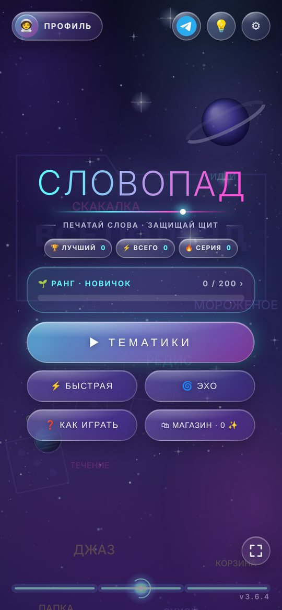
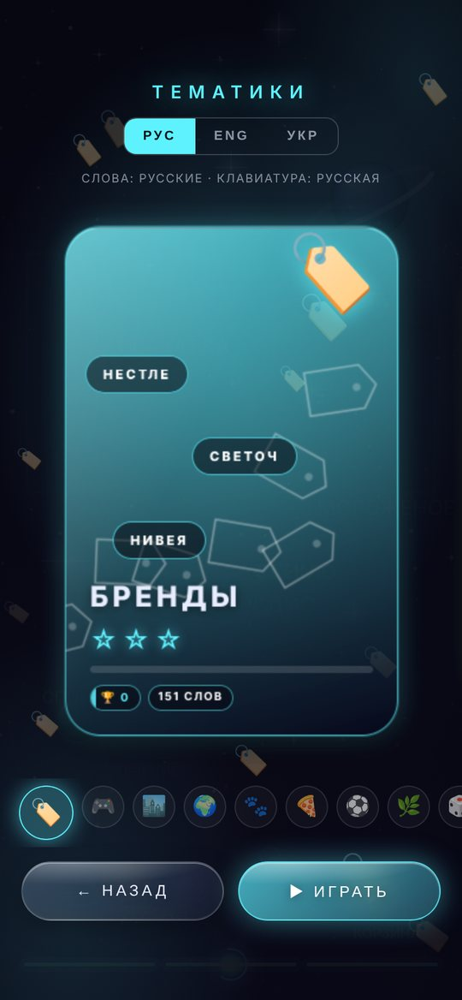
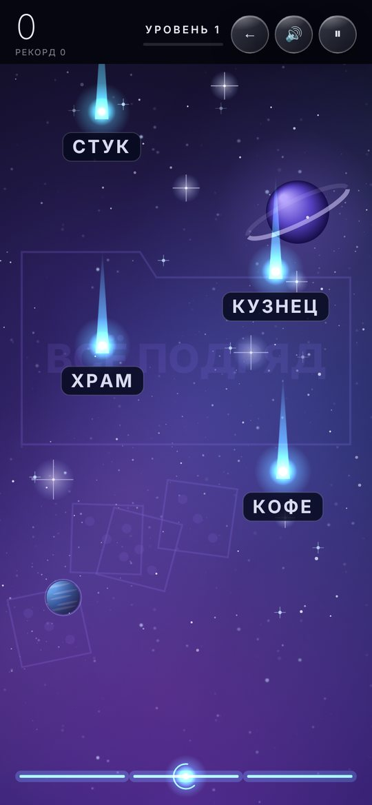
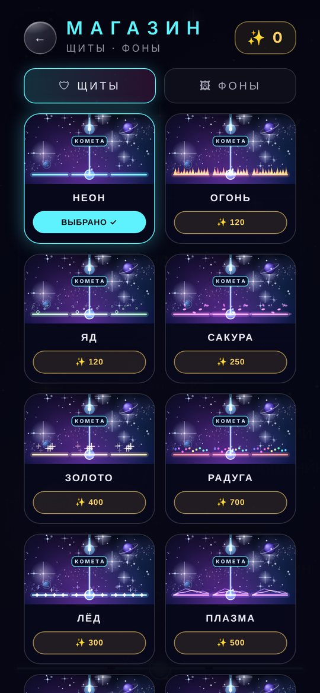

# СЛОВОПАД

Аркадная игра на скорость печати. Сверху падают слова, ты набираешь их, пока они не долетели до щита. Чем дольше держишься, тем быстрее и длиннее слова.

## ▶ [Играть](https://felykxzy.github.io/slovopad.game/)

Работает в браузере на телефоне и компьютере, без регистрации. Можно установить как приложение, тогда игра открывается с иконки на весь экран и работает без интернета.

**Текущая версия: 3.8.0** (14 ноября 2026) · [Что нового](#что-нового-в-380) · [История версий](CHANGELOG.md)

## Как это выглядит

<table>
<tr>
<td align="center"> Меню</td>
<td align="center"> Тематики</td>
<td align="center"> Игра</td>
<td align="center"> Магазин</td>
</tr>
</table>

---

## Как играть

1. Выбери тему и нажми «Играть» (или «Быстрая игра» для случайного микса).
2. Набирай слова, которые падают. Набрал слово целиком, оно взрывается и приносит очки.
3. Если слово долетело до щита, теряешь одну жизнь из трёх. Не осталось жизней, игра окончена.
4. Набирай слова подряд без ошибок: растёт комбо и множитель очков.
5. Каждые 8 слов начинается новый уровень, и игра ускоряется.

Особые слова:

- **Золотые** дают тройные очки.
- **«Жизнь»** возвращает одну потерянную жизнь.

Управление: на телефоне печатай на экранной клавиатуре, на компьютере на обычной. **Esc** ставит игру на паузу.

## Возможности

- **Канал автора:** значок Telegram в шапке меню (рядом с лампочкой) ведёт на [t.me/kilozexui](https://t.me/kilozexui).
- **Приложение для компьютера:** сборка для Windows, macOS и Linux (см. ниже).
- **Магазин:** 8 скинов щита и 8 анимированных фонов за ✨ (награда за игры), у каждого живая карточка с предпросмотром.

- **Обучение:** при первом запуске игра показывает кнопки меню, объясняет правила и даёт потренироваться. Потом всё это можно открыть кнопкой «Как играть».
- **Достижения:** 32 награды за разные успехи, за каждую дают ✨.
- **Звонки:** голосовой и видеозвонок в комнате Эхо, до 4 человек.
- **Заезды:** в комнате Эхо все печатают одни и те же слова и сравнивают результат.
- **Друзья:** список друзей, общий топ, запросы, профиль друга и вызовы на соревнование.
- **Вход по QR-коду:** можно быстро войти в свой аккаунт на другом устройстве, наведя камеру на код.
- **9 тем:** бренды, игры, города, страны, животные, еда, спорт, природа и «всё подряд».
- **3 языка:** русский, английский, украинский. Язык интерфейса и язык слов выбираются отдельно. Если включена не та раскладка клавиатуры, игра подскажет, какую нужно включить.
- **Ранги:** шесть ступеней от Новичка до Легенды. Чем выше ранг, тем сложнее игра.
- **Профиль:** свой ник и аватарка (эмодзи или фото), статистика: точность, слов в минуту, лучшее комбо, время в игре, число игр.
- **Рекорды** отдельно по каждой теме и языку, серия дней подряд.
- **Звук и вибрация,** настройки скорости и качества картинки (есть экономный режим для слабых телефонов).
- **Установка как приложение (PWA)** и офлайн-режим.
- **Компьютер:** адаптивный интерфейс и управление с клавиатуры.
- **Идеи для игры:** лампочка в меню отправляет твою идею разработчику в Telegram.

## Установка на телефон

Бесплатно, обновления приходят сами.

**iPhone и iPad** (только Safari):
1. Открой игру в Safari.
2. Нажми «Поделиться» (квадрат со стрелкой).
3. Выбери «На экран Домой» → «Добавить».

**Android** (Chrome): меню ⋮ → «Установить приложение» (или «Добавить на главный экран»).

**Компьютер** (Chrome или Edge): значок установки в правой части адресной строки.

## Приложение для компьютера

Это обычная программа для Windows, macOS и Linux. Её можно поставить и играть без браузера.

**Как установить на Windows:**

1. Открой страницу [Releases](https://github.com/Felykxzy/slovopad.game/releases) и найди самую верхнюю версию.
2. Внизу, в блоке **Assets**, скачай файл `Slovopad-Installer-….exe`. Это красивый установщик игры. Если он по какой-то причине не запускается, возьми запасной `Slovopad-Setup-….exe`.
3. Запусти скачанный файл (первый запуск открывается несколько секунд), нажми «Установить» и дождись «Готово». Папку лучше оставить ту, что предложена по умолчанию.
4. Играй с ярлыка «СЛОВОПАД» на рабочем столе.

Если Windows пишет «Система Windows защитила ваш компьютер», нажми «Подробнее», потом «Выполнить в любом случае». Так бывает, потому что у программы пока нет платной подписи. Это нормально.

**Как установить на Mac:** скачай файл `.dmg`, открой его и перетащи игру в «Программы». При первом запуске нажми на иконку правой кнопкой, выбери «Открыть» и ещё раз «Открыть».

**Как запустить на Linux:** скачай файл `.AppImage`, разреши ему запускаться (правая кнопка → «Свойства» → «Разрешить выполнение») и открой двойным щелчком.

**Обновления:** на Windows и Linux игра сама находит новую версию и спрашивает, перезапустить ли её. На Mac новую версию надо скачать самому, так же, как первую.

## Что нового в 3.8.0

- **Звонки в Эхо:** в комнате можно говорить голосом и включать камеру, до 4 человек сразу

## Что было в прошлой версии (3.7.0)

- Заезды в комнатах, ответы и реакции в чате, умный ИИ-помощник

Все остальные версии: [CHANGELOG.md](CHANGELOG.md).
